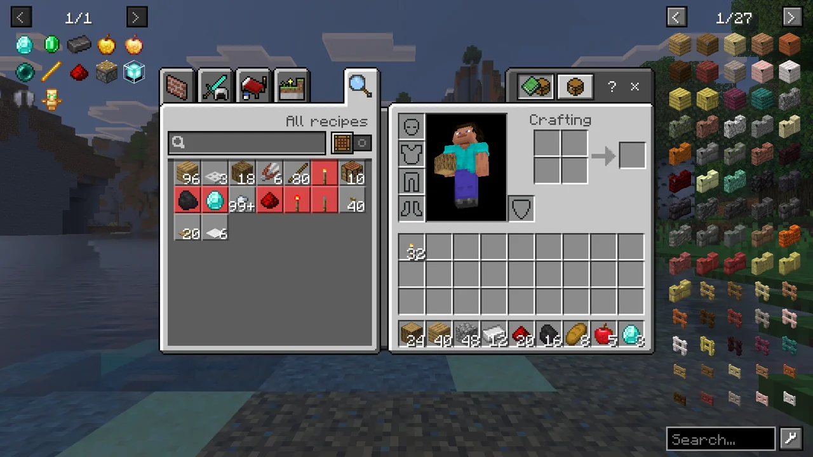
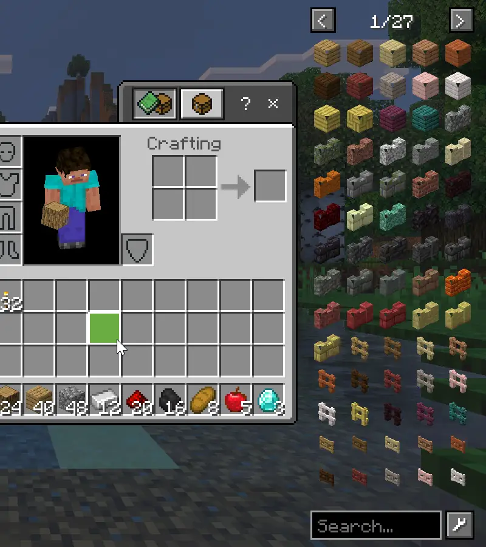
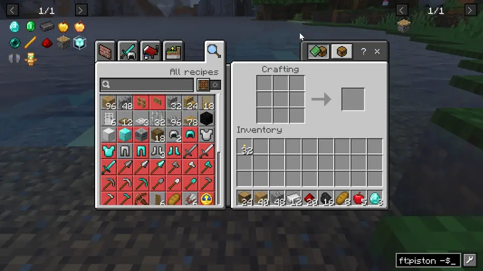

# BEI — Barely Enough Items


[](https://github.com/LiteLDev/BarelyEnoughItems/releases)
[](COPYING.LESSER)

Never alt-tab to a wiki again. BEI puts every item in the game next to your inventory, and shows how to make it and what it is good for — [Just Enough Items (JEI)](https://github.com/mezz/JustEnoughItems) from Java Edition, now on Minecraft Bedrock for Windows.



## Features

- **Every item at hand** — a searchable item list beside the inventory, crafting table, furnace, chest and every other container.
- **Recipes and uses** — press `R` on any item to see how to make it, `U` to see what it is used for: crafting, smelting, smithing, stonecutting, brewing, anvil repair, composting and more.
- **One-click crafting** — the `+` button moves a recipe's ingredients from your inventory into the crafting grid or furnace.
- **Smart search** — filter by name, tag, namespace or id, exclude words, and search Chinese names by pinyin.
- **Bookmarks** — pin the items you keep looking up to a list on the left.
- **Cheat mode** — with cheats on, click an item to take a stack.



BEI only runs on your game: it works in single-player and on any server, and the server does not need it.

## Install

You need Minecraft Bedrock **1.26.51.01** for Windows (x64) with LeviLamina **26.51.x**, for example installed through [LeviLauncher](https://github.com/LiteLDev/LeviLauncher).

With [lip](https://github.com/futrime/lip):

```sh
lip install github.com/LiteLDev/BarelyEnoughItems#client
```

Or download `bei-client-windows-x64.zip` from the [latest release](https://github.com/LiteLDev/BarelyEnoughItems/releases/latest) and extract it so that the `BEI` folder lands in the game's `mods/` folder.

## How to use

Open your inventory or any container. The item list is on the right, your bookmarks on the left.



| Key / click | What it does |
| --- | --- |
| `R` or left click | Recipes for the item under the mouse |
| `U` or right click | Uses of the item under the mouse (on a furnace or other workstation: everything it makes) |
| `+` next to a recipe | Move the ingredients into the open crafting grid, furnace or smithing table. `Shift`-click moves as many as you can make. Missing ingredients turn red. |
| `A` | Add or remove a bookmark |
| `Backspace` | Back to the previous recipe page |
| `O` | Show or hide the item list |
| `Ctrl` + `F` | Jump to the search bar (`↑` `↓` bring back earlier searches, right click clears it) |
| Mouse wheel, `<` `>` | Turn pages |

The keys work over the item list, over your own inventory slots and inside the recipe page, and you can change them in *Settings → Keyboard & Mouse*. In the recipe page, click a tab to switch category, click an ingredient for its recipes (right click for its uses), and click a workstation on the left to see everything it makes.

### Search

| Type | To find |
| --- | --- |
| `oak planks` | Items whose name contains both words |
| `stone\|dirt` | Either word |
| `-slab` | Everything except slabs |
| `@minecraft` | Items from one namespace (mod or add-on) |
| `#planks` | Items with that item tag |
| `$oak_` | Items whose id contains the text |
| `"red wool"` | That exact phrase |
| `mb`, `muban`, `木板` | Chinese names by pinyin initials, full pinyin or characters |

### Cheat mode

If you may use commands (operator, or cheats enabled in the world), `Ctrl`-click the settings button next to the search bar. The button turns red, and clicking the list gives you items: left click a stack, right click or `Shift`-click one. In creative mode, clicking the list while holding an item deletes it.

## Settings

Click the settings button next to the search bar:

| Option | |
| --- | --- |
| Cheat mode | Click items in the list to take them |
| Bookmark panel | Show the bookmarks on the left |
| Add new bookmarks to the front | Newest bookmark first |
| Search bar under the container | Center the search bar below the inventory |
| Show item ids / mod name in tooltips | Extra tooltip lines |
| Remember the item list page | Reopen the list where you left it |
| Show on all container screens | Off: only on the inventory and the crafting table |
| Max columns | Make the item list narrower |

Settings and bookmarks are saved in `mods/BEI/config/` (`config.json`, `bookmarks.json`).

## More

More screenshots and videos: https://levimc.org/mods/github.com/LiteLDev/BarelyEnoughItems/?tab=gallery

Found a bug or have an idea? [Open an issue](https://github.com/LiteLDev/BarelyEnoughItems/issues/new/choose).
Building it yourself or contributing? See [CONTRIBUTING.md](CONTRIBUTING.md).

## License

[LGPL-3.0](COPYING.LESSER) © 2026 Zijian Zhang. BEI is not affiliated with Mojang Studios, Microsoft or the JEI project.
